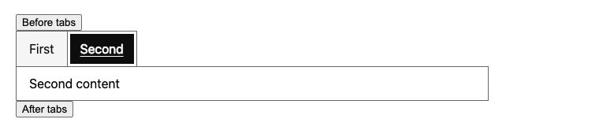

# Keyboard and browser observations — 29 October 2026

These results describe selected interactions with Accesserty UI Kit 3.0.2.
Codex operated the browser step by step and inspected visible state and the
accessibility tree. No independent human sign-off or screen-reader session was
performed. A pass applies only to the listed subcase and environment.

## Environment

| Field | Tested value |
|---|---|
| Date and timezone | 29 October 2026, Asia/Taipei (UTC+08:00) |
| OS | macOS 27.0.1, build 26A434 |
| Browser | Google Chrome 156.0.8078.48 |
| Distribution | Fresh readable bundle for UI observations; source/readable/minified modes in the automated controls suite |
| Readable bundle SHA-256 | `6984e829becdf2953a26cf0d3bdfdb6648cb7418b9090d55cc27ca05c9b699eb` |
| Minified bundle SHA-256 | `135df937b60f08ba381bddcf1d476248208443950b5c105e6b8626e83dfa8481` |
| Screen reader | Not active; no speech observed |
| Visual conditions | Default fixture styling; final Controls viewport 2485 × 1233 CSS pixels. Exact zoom and OS keyboard settings were not recorded. |

The bundle hashes identify the actual artifacts observed, even when a later
commit or rebuild changes them. Use the [procedures](../manual-test-plan.md) and
[record template](../record-template.md) to repeat a case. Component source and
the small fixtures are available in this repository.

## Scoped UI observations

Controls below means [the controls fixture](../../../test/browser/fixtures/controls.html?mode=bundle).
For other rows, the linked fixture loads the same readable bundle. Setup focus
was placed on the preceding control before Tab, except where stated otherwise.

| Case/subcase | Actions and observed outcome | Result |
|---|---|---|
| INPUT-K01/entry-typing-exit | Controls: Tab from Before input, enter synthetic text, Tab. The field accepted text and focus reached After input. | PASS |
| TEXTAREA-K01/multiline-exit | Controls: Tab from Before notes, type two lines separated by Enter, Tab. Both lines remained and focus reached After notes. | PASS |
| CHECKBOX-K01/basic | Controls: Tab from Before checkbox, Space twice, Tab. Accept changed off → on → off; focus reached After checkbox. | PASS |
| SWITCH-K01/basic | Controls: Tab from Before switch, Space, Tab. Notifications changed off → on; focus reached After switch. | PASS |
| RADIO-K01/ltr | Controls: Tab from Before radio, Right twice, Tab. Standard → Express → Standard skipped the disabled option and wrapped; focus reached After radio. | PASS |
| RATING-K01/basic | Controls: Tab from Before rating, Right, Tab. Rating changed 2 → 3, score displayed 3 / 5 and focus reached After rating. | PASS |
| TABS-K01/text-only-panels | Controls: Tab from Before tabs, Right, Home, End, Tab twice. Selection and content agreed; focus moved through the selected text-only panel to After tabs. | PASS |
| FORM-K01/controls-reset | After the edits above, Enter on native Reset cleared Input/Textarea, switched Notifications off and restored Rating to 2. Focus stayed on Reset. Checkbox/Radio were already at their initial values; their changed-state reset was not established by this action. | PASS |
| DROPDOWN-K01/basic-close-focus | [Dropdown fixture](../../../test/browser/fixtures/dropdown-bundle.html): Tab from Before menu, Enter, Down, Escape. Focus moved Edit → Save, then returned to the collapsed trigger. Reopen/Enter closed with trigger focus; callback/value was not separately checked. | PASS |
| ACCORDION-K01/exclusive | [Accordion fixture](../../../test/browser/fixtures/accordion-bundle.html): Tab from Before, Enter/Space to collapse/reopen, Tab into content and to the second toggle, Enter. Second opened while First closed; Tab could leave through its content to After. | PASS |
| CARD-K01/descendant-order | [Card fixture](../../../test/browser/fixtures/card-bundle.html): Tab from Before through Preview guide → Media details → Guide notes → Save guide → After, without an extra container stop. | PASS |
| BREADCRUMBS-K01/traversal-link | [Breadcrumbs fixture](../../../test/browser/fixtures/breadcrumbs-bundle.html): direct setup focus on Home; Tab through Components to After skipped Current page. Shift+Tab/Enter followed the local Components link. Entry into Home was not tested. | PASS |
| CAROUSEL-K01/last-boundary | [Carousel fixture](../../../test/browser/fixtures/carousel-bundle.html): Tab from Before and Right reached Forest; Tab entered Forest guide. Previous/Next returned through City to Forest; Next disabled at the last slide and Tab reached After. | PASS |
| TREE-K01/navigation | [Tree fixture](../../../test/browser/fixtures/tree-bundle.html): Tab from Before tree, Right, Down, Left twice, End, Home, Tab. Files expanded, Alpha received focus, Files collapsed, endpoints were reachable and focus reached After tree. | PASS |
| PAGINATION-K01/page-buttons | [Pagination fixture](../../../test/browser/fixtures/pagination.html?mode=bundle): direct setup focus on page 1; Tab/Enter selected pages 2 and 3. Next/Last disabled at page 3; Tab skipped them and could leave through the go-to controls. | PASS |
| FILE-UPLOAD-K01/open-cancel | [File Upload fixture](../../../test/browser/fixtures/file-upload-bundle.html): Tab from Before to Choose files, native Enter opened the macOS chooser, Escape returned focus to Choose files. No file was selected in this UI case. | PASS |
| TABS-V01/focus-current-size | The selected Second tab, keyboard focus outline and Second content were visible at the recorded size. Zoom, narrow layout and numeric contrast were not checked. | PASS |

This image documents one visual state. The other rows are operator observations,
not video recordings or screen-reader transcripts.

## Automated checks in the same session

These ran with Node.js 26.12.1 and exited successfully. Browser scripts used
headless Chrome. They are separate from the UI observations above.

| Command | Recorded scope | Exit |
|---|---|---|
| `npm run build` | Full bundles, standalone components, integrations and declarations | 0 |
| `node test/browser/controls.mjs chrome` | Seven types in five page/mode combinations: file bundle/minified and HTTP source/bundle/minified; typing, keyboard selection, events, focus retention, RTL, FormData, reset and disabled fieldsets | 0 |
| `node test/browser/form-flow.mjs` | Local invalid-submit/error-summary focus, correction, reset and FormData including rating/files; no real application transmitted | 0 |
| `npm run test:docs` | Toolchain, CSS documentation, build output and demo/test inventory contracts | 0 |

These are dated observations, not evidence of a current remote CI run. Scripts
and repeatable procedures are public; raw local execution logs are not included.

## Untested areas and known limits

| Area | Status and limit |
|---|---|
| Screen readers | NOT RUN: no VoiceOver, NVDA, JAWS or TalkBack speech/navigation session; the accessibility tree does not substitute for speech. |
| Other browsers/devices | NOT RUN: Firefox, Safari, iOS and Android UI sessions. |
| Frameworks | NOT RUN in this session: Vue/Nuxt and React/Next UI/SSR fixtures. Existing integrations are described in the [framework test guide](../../../test/ssr/README.md). |
| Visual variants | NOT RUN: 200% zoom, 320px layout, custom/dark themes, forced colors, reduced motion and numeric contrast. |
| Additional control variants | NOT RUN: Input clear/caret navigation, Textarea caret navigation, disabled Checkbox/Switch, Radio RTL UI, Rating bounds/readonly, Accordion closed-content Tab skipping, Tree type-ahead/checkboxes, Pagination page size and manual File Upload select/remove. |
| Application flows | NOT RUN as manual cases: complete application-form submission/correction and native-input Enter comparison. The form-flow script is automated evidence only. |
| Implicit Enter submission | `au-input` does not implicitly submit the form, as documented in the [usage reference](../../USAGE.md#validate-the-other-form-components). This was not newly reproduced or fixed in this run. |

No failure was observed in the listed scoped UI cases. The pending cases remain
unverified. These results do not establish complete component accessibility,
screen-reader compatibility or application-level WCAG conformance.
